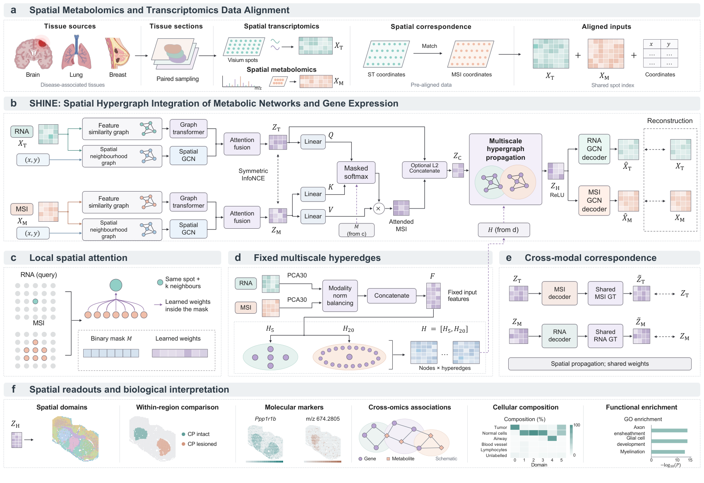

# SHINE

SHINE integrates paired spatial RNA and mass spectrometry imaging (MSI) data.
It learns a shared representation for tissue partitioning and molecular analysis.

[](https://pypi.org/project/shine-omics/)



[Figure 1 (PDF)](docs/figures/Figure1.pdf). Registration is performed upstream;
the package accepts paired, preprocessed inputs. Cross-modal support, loss, pre-fusion L2, and the
within-modality spatial weight floor are configurable.

Figure 2 (A1/B1/C1) uses the registered SMA data released with [NicheTrans](https://github.com/YSTLab/NicheTrans). Figure 3 uses the original SMA author pairing. Registration is completed before SHINE training.

## Install

Python 3.8–3.11:

```bash
python -m pip install "shine-omics[analysis]==0.1.1" jupyterlab
```

The distribution is `shine-omics`; import it as `shine`. PyTorch Geometric is
not required by the current API. CPU is the reference backend.

```python
from shine import SHINE, prepare_paired

# Paired spots in the same order; RNA and MSI are already normalized/log-transformed.
data, graphs = prepare_paired(rna, msi, xy, spot_ids=spot_ids)
model = SHINE(loss="original", l2=False, spatial_floor=0.0)
embedding = model.fit_transform(data, epochs=120, seed=123)
labels = model.cluster(n_clusters=11, seed=0)
```

See the [API guide](shine-omics-pypi/README.md),
[input format](shine-omics-pypi/docs/input_format.md), and
[synthetic example](shine-omics-pypi/examples/quickstart.py).

## Seven section notebooks

Each notebook contains saved outputs, model replay, five-fit metrics, spatial
maps, attention weights, and the measured molecular panels for its section.

| Section | Figure | Notebook | K | Loss | L2 | Spatial floor |
|---|---:|---|---:|---|---|---:|
| A1 / mPD1 | 2 | [A1](notebooks/01_A1_SHINE.ipynb) | 11 | Original | On | 0 |
| B1 / mPD3 | 2 | [B1](notebooks/02_B1_SHINE.ipynb) | 11 | Original | On | 0 |
| C1 / mPD4 | 2 | [C1](notebooks/03_C1_SHINE.ipynb) | 11 | Original | Off | 0 |
| mPD3 substantia nigra | 3 | [mPD3](notebooks/04_mPD3_SN_SHINE.ipynb) | 11 | Original | On | 0 |
| mPD4 substantia nigra | 3 | [mPD4](notebooks/05_mPD4_SN_SHINE.ipynb) | 11 | Original | On | 0 |
| LC091 lung cancer | 4 | [LC091](notebooks/06_LC091_SHINE.ipynb) | 5 | Reconstruction | Off | 0.5 |
| BC_515_S1 breast cancer | 5 | [BC_515_S1](notebooks/07_BC_515_S1_SHINE.ipynb) | 7 | Reconstruction | Off | 0 |

All use 128-dimensional embeddings, 120 epochs, hypergraph propagation, and
final ReLU. Cross-modal attention uses self+4 in A1/B1/C1 and self+6 elsewhere;
the spatial encoder graph remains kNN6. Pass `local_k=4` to `prepare_paired`
to select four neighbors, or `local_mask=False` for all-spot attention. A spatial floor of 0.5 specifies at least 50% spatial-branch weight
within each modality; it does not set the RNA/MSI mixing ratio.

## Data and reproduction

Original studies and download links are listed in [data/README.md](data/README.md).
The processed data archive is not yet publicly released. Saved notebook outputs
are available to view. The updated manifest requires the four-neighbor A1/B1/C1
files in addition to the earlier archive. For the supplied revision package,
extract `SHINE_figure_data_v0.1.0.tar.gz` into `data/` and copy
`Updated_Figure_Data/` into the same directory before checking the manifest:

```bash
tar -xzf SHINE_figure_data_v0.1.0.tar.gz -C data
python scripts/check_figure_data.py --root data
jupyter lab notebooks
```

Use `SHINE_DATA_ROOT` for another data directory. Notebooks load the saved model
by default; set `RUN_NEW_TRAINING=True` to train a new model.

ARI/NMI summaries use training seeds 0, 1, 2, 123, and 1234, averaging five
KMeans seeds within each fit before calculating mean and sample SD. Spatial
plots use training seed 123. Regional metrics subset the whole-section labels
without reclustering. See [reproducibility](shine-omics-pypi/docs/reproducibility.md)
for numerical limitations, including the mPD4 retraining difference.

[Model equations and code](docs/model.md) describe the active forward pass,
losses and hypergraph operator.

## Source and earlier workflows

- [Current package source](shine-omics-pypi), matching PyPI 0.1.1.
- [Historical scripts and notebooks](legacy/README.md), retained for earlier results.
- [Issues](https://github.com/Elsa-bingxue/SHINE/issues).

To install the source checkout: `python -m pip install -e './shine-omics-pypi[analysis]'`.
